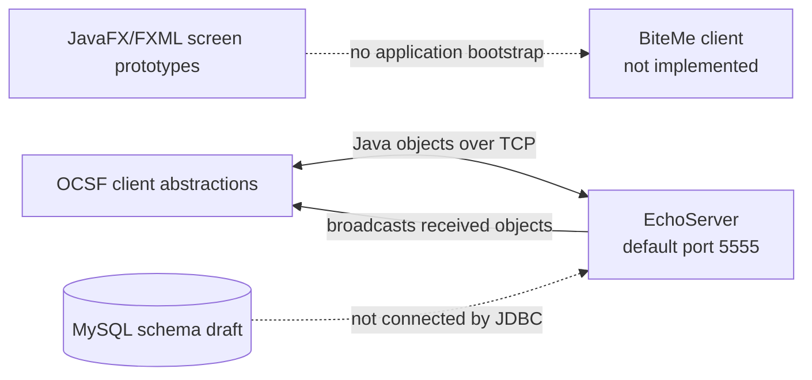

# BiteMe

> A Java 8 client-server restaurant-ordering prototype that combines JavaFX interface designs, OCSF socket networking, and a MySQL relational schema.

## Overview

BiteMe is a multi-project Eclipse workspace created to explore the foundations of a desktop restaurant-ordering system. The repository contains a runnable TCP echo/broadcast server, reusable OCSF networking classes, JavaFX/FXML screen prototypes, and a detailed MySQL schema draft for restaurants, customers, orders, menus, and reports.

The checked-in application is an **early prototype**, not a complete ordering platform. The server networking path is implemented; the JavaFX controllers, application-specific client, and database integration are currently scaffolding. This distinction is documented throughout the README so the repository can be evaluated accurately.

## Current Functionality

| Area | Status | What is present |
| --- | --- | --- |
| TCP server | Implemented | Accepts Java-serialized objects, logs each received message, and broadcasts it to connected clients. |
| Server configuration | Implemented | Uses port `5555` by default or accepts a port as the first command-line argument. |
| OCSF networking | Implemented | Vendored client/server abstractions with threaded connections and object streams. |
| Desktop interface | Prototype | FXML layouts for login, home, and server-monitoring screens. |
| Restaurant workflows | UI scaffold only | Buttons exist for ordering, menu updates, customer creation, reports, order history, and logout, but their handlers are empty. |
| Database | Schema draft | MySQL tables, triggers, sanitized demo records, menu data, order data, and report structures. |
| Persistence | Not connected | The Java server does not currently open a JDBC connection or query the database. |
| Application client | Not implemented | No BiteMe-specific client class or JavaFX `Application` entry point is checked in. |

## Technology Stack

| Technology | Role |
| --- | --- |
| Java 8 | Application language and configured compiler target |
| JavaFX / FXML | Desktop interface layouts and controllers |
| OCSF 2.12 | Object Client-Server Framework bundled as source |
| TCP sockets and Java object serialization | Client-server transport used by OCSF |
| MySQL SQL | Relational schema, triggers, and demo data |
| Eclipse JDT | Project structure and Java build metadata |

There is no Maven or Gradle build file in the current repository.

## Architecture



The runnable path is `EchoServer` plus the OCSF server classes. The UI and database artifacts describe the intended application boundaries but are not wired into that path.

## Repository Structure

```text
BiteMe-master/
├── BiteMeClient/                 # Eclipse client project shell; no client source is present
├── BiteMeCommon/
│   └── src/
│       ├── common/               # Shared interface and placeholder user model
│       └── gui/                  # JavaFX login/home FXML and controllers
├── BiteMeServer/
│   └── src/
│       ├── gui/                  # Prototype server-monitoring FXML/controller
│       └── server/               # EchoServer entry point and placeholder DB/UI classes
├── OCSF/
│   └── src/ocsf/                 # Reusable OCSF client and server framework
├── BiteMeDatabaseFull.sql        # MySQL schema draft and sanitized demo data
├── .gitignore
└── README.md
```

## Prerequisites

- JDK 8. The project metadata targets Java 8, whose standard distribution includes JavaFX.
- Eclipse IDE for Java Developers is recommended because the repository is organized as linked Eclipse projects.
- MySQL 8.x is optional for inspecting and developing the database schema.

## Installation

```bash
git clone https://github.com/yosef2000138/BiteMe-master.git
cd BiteMe-master
```

### Import into Eclipse

1. Open **File → Import → General → Existing Projects into Workspace**.
2. Select the repository root.
3. Import `OCSF`, `BiteMeCommon`, `BiteMeServer`, and `BiteMeClient`.
4. Select a Java 8 JRE for the workspace.
5. If Eclipse does not resolve JavaFX automatically, create the JavaFX user library referenced by the project metadata.

## Running Locally

### Run the implemented server in Eclipse

1. Open `BiteMeServer/src/server/EchoServer.java`.
2. Choose **Run As → Java Application**.
3. Optionally add a port such as `6000` under **Run Configurations → Arguments**. Without an argument, the server listens on `5555`.

### Run the implemented server from a terminal

The server portion can be compiled without JavaFX or MySQL:

```bash
mkdir -p out
javac -d out $(find OCSF/src -name '*.java') \
  BiteMeServer/src/server/EchoServer.java
java -cp out server.EchoServer 5555
```

Expected startup output:

```text
Server listening for connections on port 5555
```

The repository does not currently contain a launchable BiteMe client. A compatible client must use the OCSF classes and Java object serialization; HTTP tools such as `curl` are not compatible with this protocol.

## Environment Configuration

The current Java source does **not** read environment variables or `.env` files.

| Setting | Current configuration | Default |
| --- | --- | --- |
| Server port | First command-line argument | `5555` |
| Database connection | Not implemented in Java | N/A |
| Database credentials | Not read by the application | N/A |

If database integration is added later, keep credentials in a local, ignored `.env` file and use safe placeholders in documentation:

```dotenv
DB_HOST=localhost
DB_PORT=3306
DB_NAME=biteme_database
DB_USER=<your-local-database-user>
DB_PASSWORD=<your-local-database-password>
```

Creating this file alone will not configure the current application; code must first be added to read the values.

## Database Schema

`BiteMeDatabaseFull.sql` models two MySQL schemas:

- `biteme_database` for branches, menus, menu items, additions, user roles, customers, orders, and quarterly reports.
- `biteme_usermanagement` for user-registration data.

The seed records use reserved example domains, fictional phone numbers, and explicit non-secret credential/payment placeholders.

The SQL is a design artifact and has two known pre-existing consistency issues that must be corrected before an end-to-end import:

1. `order_items` defines constraints using a `category` column that is not declared in that table.
2. The `orders` seed statement inserts into `start_time`, while the table declares `desired_time`.

After resolving those schema issues, a local import can be performed with:

```bash
mysql -u <your-local-database-user> -p < BiteMeDatabaseFull.sql
```

The database is not currently used by `EchoServer`.

## Network Protocol Reference

This project does not expose a REST or HTTP API.

| Property | Behavior |
| --- | --- |
| Transport | TCP through OCSF |
| Default port | `5555` |
| Payload format | Java-serialized objects |
| Server behavior | Logs each received object and broadcasts it to all connected clients |
| Authentication | Not implemented |
| Persistence | Not implemented |
| Versioning | Not implemented |

## Testing

No automated test suite or test framework is included. A basic manual server check is:

1. Compile the OCSF sources and `EchoServer` using the terminal command above.
2. Start the server and confirm that it reports the selected listening port.
3. Connect an OCSF-compatible Java client and confirm that a sent serializable object is logged and broadcast.

The JavaFX screens and SQL import require additional implementation/fixes before they can be tested end to end.

## Security Notes

- Real secrets, database credentials, and environment files must not be committed.
- The SQL seed values are demonstration placeholders only and must never be reused as real credentials or payment data.
- Build artifacts, local environment files, IDE caches, keys, keystores, and credential files are excluded by `.gitignore`.

## Project Status

This repository is best viewed as an educational architecture prototype: it demonstrates the project boundaries and a working object-stream server while clearly exposing the next implementation steps—client bootstrapping, controller logic, request models, JDBC persistence, schema cleanup, and automated tests.
